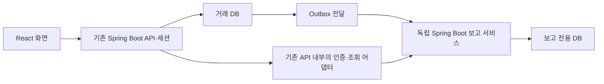

# 문제 해결을 위한 단계적 MSA 전환 설계

설계 v4 Java·Spring Boot + React / 2026-10-20 / 전환 작업 미착수

목표는 마켓플레이스를 먼저 완성하고, 재현한 문제를 근거로 필요한 영역을 서비스로 분리하는 것이다. [구현 계획](implementation-plan.md)의 P13~P14에서 실행한다. 지금 서비스·서버·브로커를 생성하지 않는다.

## 1. 출발점과 도착점

출발점은 한 저장소의 React 프런트엔드와 Java·Spring Boot API 백엔드다. 백엔드는 단일 Maven 프로젝트와 PostgreSQL을 사용하는 모듈형 모놀리스이며 Java 패키지별 모듈이 데이터를 소유하고 공개 인터페이스·DTO로 연결된다. Spring JDBC·Flyway를 사용하며 worker는 같은 JAR·버전·DB의 백그라운드 실행 역할이다. React와 API의 빌드가 나뉘어 있다는 사실만으로 MSA로 분류하지 않는다. [현재 기술 결정](decisions/ADR-001-java-spring-react.md)을 따른다.

첫 도착점은 선정된 업무 하나가 전용 데이터 저장소와 배포 단위를 갖고 네트워크 계약으로 연결되는 구조다. 여러 프로세스로 나눴더라도 다른 서비스의 테이블을 직접 수정하고 항상 함께 배포해야 한다면 분리 목표를 달성한 것으로 판단하지 않는다.

사용자의 MSA 학습 목표를 위해 실제로 재현 가능한 문제를 선정한다. 모놀리스에서 더 간단히 해결되는 문제는 그 결과도 기록하고, 서비스 분리가 도움이 되는 다른 장애·변경·부하 조건을 검증한다. 인위적인 학습 시나리오는 실제 운영 장애처럼 표현하지 않는다.

첫 분리 서비스도 Java·Spring Boot를 기본으로 한다. 새로운 백엔드 언어 도입과 프로세스·데이터 분리를 동시에 필수 과제로 만들지 않는다. Kotlin·Python·Node.js 기반 업무 서버, Spring Cloud·브로커·Kubernetes는 별도의 문제와 이득이 확인될 때만 결정한다. React 개발·빌드를 위한 Node.js는 초기 구성에 이미 포함되며 업무 서비스 분리와는 별개다.

## 2. 분리 후보와 판단 근거

아래 순서는 검토 난이도에 대한 제안이며 확정된 분리 순서가 아니다.

| 문제 후보 | 먼저 비교할 내부 개선 | 분리 후보 | 분리로 얻으려는 효과 | 추가 비용 |
| --- | --- | --- | --- | --- |
| 알림 제공자 지연이 주문 응답에 전파 | Outbox·worker·제한시간·재시도 | notification | 제공자 장애 격리·독립 재시도/배포 | 전달 지연·중복·관측 |
| 통계 조회가 구매 DB와 자원을 경쟁 | 인덱스·읽기 projection·집계 작업 | reporting | 조회 자원·배포 격리 | 집계 지연·재구축·대사 |
| 검색 부하와 검색 변경이 구매에 영향 | 조회 최적화·캐시·검색 인덱스 | catalog/search | 독립 확장·검색 변경 분리 | 색인 지연·공개 상태 일치 |
| 배송사 장애·업데이트가 구매 배포에 영향 | 어댑터·worker 격리 | fulfillment | 제공자 장애·배포 격리 | 배송 이벤트 순서·재시도 |
| 정산 작업이 거래 처리와 배포에 결합 | 배치 개선·원장·실행 시간 분리 | settlement | 정산 실행·권한·배포 경계 | 금액 대사·사후 조정 |
| 주문·재고 경쟁과 독립 확장 요구 | 조건부 갱신·잠금·쿼리 개선 | inventory 또는 order | 데이터 쓰기 책임·확장 경계 | 예약·보상·분산 일관성 |

주문·재고·결제는 거래 일관성 비용이 크므로 처음부터 모두 분리하지 않는다. 낮은 위험의 분리로 운영 경험을 얻은 뒤 측정 결과가 있는 영역으로 확대한다.

## 3. 재현과 측정

P13-A에서 다음 내용을 한 문제 보고서에 기록한다.

| 항목 | 기록 내용 |
| --- | --- |
| 문제 | 어떤 사용자 행동·변경·장애에서 무엇이 실패하거나 느려지는가 |
| 조건 | 커밋, JDK·Boot·JVM 옵션, CPU·메모리, 힙·GC·스레드·연결 풀, DB 데이터 크기·인덱스, worker 수 |
| 부하 | 동시 사용자·요청 비율·지속 시간·준비 시간·테스트 데이터 생성법 |
| 장애 | 지연·오류·프로세스 중단·네트워크 단절의 주입 위치와 시간 |
| 기준 결과 | 응답 p50/p95/p99, 처리량, 오류율, DB 대기·연결·CPU, 작업 지연 |
| 업무 결과 | 주문 수·성공 결제·판매/예약/반환 수량·쿠폰·환불·정산 대사 |
| 변경 결과 | 수정 모듈·파일 범위, 함께 배포하는 구성, 영향 받은 회귀 검사 |
| 목표 | 비교 전에 정한 개선 수치 또는 장애/배포 격리 조건 |
| 반복 | 동일 조건으로 여러 번 실행한 결과와 편차 |

초기 성능 실험 예시는 상품 조회 50/100 동시 사용자, 주문 10/20 동시 사용자, 동일 SKU 재고 경쟁, 외부 제공자 3초 지연·일부 오류다. 이는 실제 서비스의 목표치가 아니라 실험 시작값이며 로컬 자원과 기준 결과에 맞게 조정한다.

재고 음수, 중복 주문·결제·환불·정산, 타인 데이터 노출은 허용하지 않는 불변식이다. 평균 속도가 개선돼도 이를 위반하면 실패다.

분리 전후에는 동일 데이터·부하·측정 구간을 사용한다. 자원을 추가했다면 비용 증가를 명시하고 같은 총자원 조건의 비교도 수행한다. 독립 배포·장애 격리가 목적이면 지연 감소만을 성공 기준으로 쓰지 않는다.

Java 실험은 워밍업·JIT 영향을 분리하고 같은 조건으로 반복한다. Actuator·Micrometer와 DB 지표로 JVM 메모리/GC·요청 스레드·연결 풀 대기·잠금을 함께 확인한다. 테스트 데이터와 읽기 캐시 조건을 기록하고 서비스 분리 자체가 GC나 SQL 병목을 해결했다고 추정하지 않는다.

## 4. 전환 절차

1. 해당 모듈의 공개 계약과 소유 데이터를 정리하고 다른 모듈의 직접 접근을 제거한다.
2. 현재 동작을 보존하는 계약·회귀 검증을 준비한다.
3. 독립 서비스의 API·이벤트·인증·제한시간·오류·재시도 계약을 설계한다.
4. 전용 DB 또는 분리된 데이터 저장소를 만들고 해당 서비스만 쓰도록 권한을 제한한다.
5. 기존 데이터를 시점 기준으로 이행하고, 그 이후 변경은 Outbox 이벤트 또는 정해진 이행 경로로 따라잡는다.
6. 읽기 결과·건수·합계·처리 위치를 비교하고 뒤처진 이벤트가 없는지 확인한다.
7. 기능 전환 스위치로 호출 경로를 바꾸고 쓰기 주체를 한쪽으로 확정한다.
8. 장애·지연·중복·재시도·복구와 기존 사용자 흐름을 검증한다.
9. 같은 실험을 다시 측정하고 개선 효과·복잡성·운영 비용을 기록한다.
10. 안정화 후 이전 경로를 제거하고 문서·실행·배포·복구 절차를 갱신한다.

동일 업무 데이터를 양쪽에 임의로 동시에 쓰는 방식은 기본안으로 사용하지 않는다. 쓰기 전환 중에는 짧은 정지 구간 또는 명시적인 단일 쓰기 경로를 두고, 이행 수위·마지막 이벤트 ID를 기록한다.

### Java 모듈에서 독립 서비스로 옮길 항목

| 기존 모놀리스 | 분리 뒤 기준 | 검증 |
| --- | --- | --- |
| 공개 Java 인터페이스·DTO 호출 | 기존 호출 측에는 어댑터를 두고 버전 있는 HTTP/이벤트 계약으로 연결 | 같은 입력·결과·권한·실패 계약. Java 직렬화 객체나 내부 클래스 공유 금지 |
| 같은 DataSource의 JDBC 저장소 | 서비스 전용 DB 자격·저장소·Flyway 이력 | 다른 서비스 업무/세션 테이블 직접 접근 차단 |
| 같은 DB의 `@Transactional` | 각 서비스의 로컬 트랜잭션 + Outbox/Inbox·명시적 보상 | 중복·응답 유실·일부 성공·프로세스 재시작 |
| 같은 Maven 앱의 패키지·worker | 별도 Boot 실행 JAR·설정·빌드/배포 절차 | 모놀리스 전체를 다시 배포하지 않고 서비스만 갱신 가능 |
| Spring Security의 API 세션 | 기존 Boot API에 세션 유지, 내부에는 검증 가능한 사용자·서비스 주체 전달 | 임의 사용자/관리자 헤더 거부, 수신 서비스 소유권 검사 |
| React의 공통 `/api` 호출 | 기존 외부 계약을 유지하고 Java의 호출 어댑터를 전환 | 화면을 서비스별 내부 주소·자격 증명에 결합하지 않음, 기존 브라우저 흐름 회귀 |

Flyway 분리 때 모놀리스의 기존 이행 파일을 수정하거나 전부 복사해 실행하지 않는다. 이전 이력은 보존하고 대상 서비스의 소유 테이블만 초기화/이행하는 별도 경로를 만든다. 비어 있는 DB와 이관된 DB에서 시작·업그레이드를 각각 검증한다. 공통 라이브러리에는 업무 저장소나 공유 엔티티를 넣어 배포 결합을 다시 만들지 않는다.

## 5. 계약과 이벤트

동기 API는 필요한 값만 전달하고 상대 DB를 공유하지 않는다. 계약에 버전, 권한 주체, 요청 ID, 중복 방지 키, 제한시간, 재시도 가능 오류를 명시한다. 재시도할 때 새 업무 요청으로 바뀌지 않도록 같은 키를 유지한다.

이벤트는 eventId, eventType, schemaVersion, aggregateId, aggregateVersion, occurredAt, correlationId, payload를 포함한다. 예시는 OrderPaid, ShipmentDispatched, ClaimCompleted, RefundSucceeded, PurchaseConfirmed다.

개인정보와 비밀번호·결제 비밀값은 이벤트에 무조건 복제하지 않는다. 수신 서비스에 필요한 최소 데이터만 전달하고 보관·접근 정책을 정한다.

업무 저장과 Outbox 저장은 생산자의 로컬 트랜잭션에서 함께 처리한다. 전송 실패는 재시도하며 소비자는 Inbox의 eventId로 중복을 제거한다. 소비자의 업무 반영과 Inbox 완료 기록도 같은 로컬 트랜잭션에서 처리한다.

최소 한 번 전달과 중복 가능성을 전제로 한다. “정확히 한 번 전달”을 가정하지 않는다. aggregateVersion 또는 업무 상태를 검사해 역순 이벤트를 보류·무시·재조회하고, 실패 대기 목록의 원인 확인과 재생 절차를 제공한다.

메시지 브로커는 첫 분리의 전달량·재생·라우팅 요구에 맞춰 선택한다. DB Outbox와 인증된 HTTP 수신으로 충분한 첫 실험도 가능하다. 도구 도입 자체를 MSA 성과로 기록하지 않는다.

## 6. 읽기 서비스의 분리 예시

reporting을 선택한 경우 거래 DB가 원본이며 보고 DB는 재구축 가능한 projection이다. 대시보드 지연 허용 범위와 갱신 시각을 표시한다. 보고 서비스 장애 때문에 상품 구매를 실패시키지 않는다.

위 인증·조회 어댑터는 초기에는 기존 Boot API 안의 기능이다. 별도 API Gateway 제품이나 인증 서버의 도입을 뜻하지 않는다. React는 기존 `/api` 계약으로 접근하고 내부 서비스의 주소와 인증은 Java에서 관리한다. 분리 서비스가 기존 세션 DB를 직접 읽도록 만들지 않는다.

projection은 초기 스냅샷과 이후 이벤트를 연결해 생성한다. 집계 중복을 방지하고 원 주문·환불 원장과 정기 대사한다. 운영 비공개 등 민감한 상태는 오래된 캐시로 노출되지 않도록 권한·공개 상태 재검증 또는 즉시 차단 경로를 별도로 둔다.

## 7. 주문·재고 분리 시 추가 설계

단일 DB 트랜잭션으로 주문·재고·쿠폰을 함께 처리하던 규칙은 서비스 분리 뒤 그대로 사용할 수 없다. 해당 경계를 분리할 때 다음 상태와 보상을 추가한다.

| 단계 | 정상 처리 | 실패·불명확 처리 |
| --- | --- | --- |
| 주문 준비 | 주문 ID·요청 키로 준비 상태 생성 | 중복 요청은 같은 준비 상태 반환 |
| 재고 예약 | SKU·수량·기한을 예약하고 reservationId 반환 | 실패 시 주문 종료, 응답 유실 시 예약 상태 조회 |
| 쿠폰 예약 | 회원·쿠폰 자격 확인 후 예약 | 실패 시 재고 예약 해제 |
| 결제 시도 | 예약 유효성을 확인하고 승인 | 결과 불명확 시 조회, 무조건 예약 해제 금지 |
| 결제 확정 | 주문 확정·재고/쿠폰 확정 명령 | 단계 일부 실패 시 재시도·대사, 새 결제 금지 |
| 주문 취소 | 결제 취소·재고/쿠폰 해제 또는 반환 | 보상 실패는 운영 확인 상태와 재처리 |

보상은 이미 일어난 결제를 없던 일로 만드는 DB 롤백이 아니다. 취소·반환이라는 별도 거래로 기록한다. 결제 확정 뒤 재고 확정이 불가능한 경우 보상 환불과 운영 대응을 실행한다.

오케스트레이터는 진행 상태·시도 횟수·마지막 결과를 저장한다. 프로세스 중단 뒤 이어서 처리할 수 있어야 한다. 각 서비스는 중복·지연된 확정/해제 명령을 현재 예약 상태와 세대 번호로 검증한다.

재고 예약 만료와 결제 승인 경쟁, 쿠폰 예약 만료, 부분 취소 수량, 환불·정산 조정은 별도 실패 시나리오로 검증한다. 이 설계를 확정하기 전에는 주문·재고·혜택을 분리하지 않는다.

## 8. 서비스 인증·관측·운영

서비스 간 요청도 인증한다. 외부 클라이언트가 보낸 관리자 헤더를 그대로 신뢰하지 않는다. 사용자 주체와 서비스 주체를 구분하고, 수신 서비스는 대상 소유권을 재검증한다.

모든 네트워크 호출에 제한시간을 둔다. 반복 실패 시 호출을 제한하고 재시도 폭주를 막는다. 구매·결제의 불명확 결과는 사용자에게 실패로 단정하지 않고 확인 중으로 보여준다.

요청·이벤트에 연결 ID를 전달해 한 주문의 흐름을 추적한다. 서비스별 응답 시간·오류율뿐 아니라 이벤트 지연·실패 대기·대사 차이·보상 대기 건수를 관찰한다.

각 서비스는 독립적인 빌드·테스트·마이그레이션·배포·되돌리기 절차를 가진다. 같은 저장소에서 관리해도 되며, 저장소 수를 늘리는 것이 목표는 아니다.

## 9. 되돌리기와 데이터 일치

읽기 전환은 원본 조회로 되돌릴 수 있게 한다. 새 서비스가 쓰기 주체가 된 뒤에는 트래픽 스위치만 이전으로 돌리지 않는다. 신규 변경의 역이행·이벤트 재생 또는 전진 복구 계획이 필요하다.

전환 전 데이터 건수·금액·원인 ID를 대사하고 전환 뒤에도 같은 검사를 수행한다. 되돌리기 테스트에는 전환 이후 생성된 주문·환불·정산 변경을 포함한다. 비밀값·개인정보가 테스트 로그와 덤프에 노출되지 않도록 가상 데이터로 수행한다.

## 10. 포트폴리오 결과물과 완료 기준

결과물은 문제 보고서, 대안 비교 결정, 전후 구조도, API/이벤트 계약, 데이터 이행·되돌리기 절차, 반복 가능한 부하·장애 실험, 비교 수치와 한계다.

완료 조건은 첫 서비스의 독립 실행·배포·데이터 소유, AC20의 실패 복구, 영향을 받는 기존 AC01~AC18 회귀 검증, AC19의 같은 조건 비교다. 개선되지 않았다면 결과를 숨기지 않고 원인·되돌리기·다음 선택을 기록한다.
