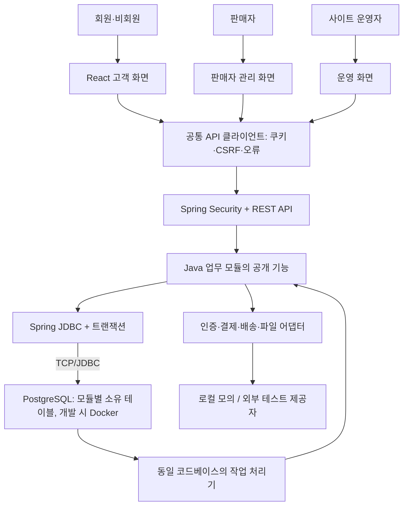

# 마켓플레이스 전체 기술 설계

현재 P01 종합 점검 결과는 [완료 점검 기록](work-items/P01-completion-audit.md)을 기준으로 한다. 회원 기반·JDBC 인증에 이어 [P02-C](work-items/P02-C.md)의 역할·운영 권한·초기 설정과 독립 검증을 완료했다. P02 전체 점검에 이어 [P03-A](work-items/P03-A.md)의 모의 판매 신청·심사·이력을 구현했다. seller는 identity.api로 회원 잠금·SELLER 부여를 요청하며 승인 거래에 상태·역할·이력을 함께 저장한다. [P03-B](work-items/P03-B.md)에서 본인 매대 생성·수정·공개 여부와 공개 조회를 구현했다. slug는 고유·불변이고 version으로 수정 충돌을 거부한다. [P03-C](work-items/P03-C.md)에서 매대 OPEN/SUSPENDED/CLOSED와 상태·비공개·버전·감사 이력의 원자적 변경을 구현했다. 복구 후에도 비공개이고 폐점은 복구/재개설하지 않는다. 역할·세션과 구매자 기능은 유지하며 실제 상품/거래는 후속 단계다. [독립 검토](work-items/P03-C-review.md)를 완료했으며 다음 단계는 미착수다.

개정일: 2026-10-21 / 설계 v4 Java·Spring Boot + React / 구현 기준 설계; 현재 상태는 P01 종합 점검 참조

서비스의 목적·기능·정책은 [요구사항](requirements.md)을 기준으로 한다. 이 문서는 그 요구사항을 화면, 권한, 데이터와 처리 구조로 연결한다. [구현 계획](implementation-plan.md)의 작은 작업마다 구체적인 필드·API 계약·검증 사례를 추가한다.

## 1. 설계 방향과 완성 범위

한 사이트 안에 구매 화면, 판매자 매대·관리 화면, 사이트 운영 화면을 제공한다. 로그인 회원과 인증한 비회원이 구매하고, 판매자는 회원의 구매 기능을 그대로 사용한다.

하나의 저장소에 React 프런트엔드와 Spring Boot API 서버를 둔다. 백엔드는 PostgreSQL을 사용하는 모듈형 모놀리스로 시작하며 인증·매대·상품·재고·혜택·주문·결제·배송·클레임·콘텐츠·운영·정산의 책임을 구분한다. 화면과 서버를 별도로 빌드하는 것만으로 MSA를 구현했다고 판단하지 않는다.

상품 옵션·이미지 업로드, 판매자 승인, 비회원 조회, 쿠폰·이벤트, 테스트 결제, 배송, 취소·반품·교환·부분 환불, 문의·신고·비공개 조치, 모의 정산과 대시보드까지 전체 기능이다. 이를 완성한 후 [MSA 전환 설계](msa-evolution.md)에 따라 문제를 재현하고 서비스를 분리한다.

## 2. 현재 환경과 기술 선택

### 채택한 구성과 기존 경험

사용자가 Java·Spring Boot 백엔드와 React 화면을 선택했다. 설계 v4는 목적·목표를 G01~G10으로 정리하고 기존 F01~F18·AC01~AC20과 서비스 정책을 유지한다. 기술 구성의 선택 이유·부담·대안·버전 정책은 [ADR-001 Java·Spring Boot + React](decisions/ADR-001-java-spring-react.md), 개발용 DB의 실행 방식은 [ADR-002 Docker PostgreSQL](decisions/ADR-002-docker-postgresql.md)을 따른다.

사용자는 Java에 꽤 유창하고 레거시 Spring·Oracle·기본 SQL 경험이 있다. React·TypeScript·브라우저 JavaScript와 Boot 설정·Spring Web·인증·트랜잭션은 필요한 기능과 함께 학습한다. 입력 → React 상태 → HTTP → Java 서비스 → SQL → 화면 갱신 흐름과 작은 직접 수정 방법을 설명하고, 자동 테스트 통과와 사용자 이해 확인을 구분한다.

| 영역 | 채택한 설계 | 이유·경계 |
| --- | --- | --- |
| 서버 언어·실행 | Java 21 LTS, Spring Boot 4.1 계열의 Servlet 앱 | 기존 Java 역량 활용, 단일 실행 JAR. 실제 패치·실행 결과는 P01-B1 기록 |
| 서버 빌드 | Maven 3.9 계열 + Maven Wrapper | backend/에서 빌드·검증. Maven 경험까지 가정하지 않음 |
| 화면 | React 19 계열·TypeScript·React Router | 구매·판매·운영 SPA. 컴포넌트·상태·라우팅·API 연동 학습 |
| 프런트 빌드 | Vite·Node 24 LTS 계열·npm | frontend/의 개발·빌드·테스트. 업무 서버 런타임은 Java |
| HTTP 서버 | Spring MVC의 REST 컨트롤러 | `/api/**`의 인증·검증·업무 처리·JSON 응답 |
| 스타일·상호작용 | 일반 CSS·React 이벤트·기능별 Hooks | 필요한 도구만 도입. 상태·오류·재시도·접근성은 별도 설계 |
| 입력 | 요청 DTO + Jakarta Bean Validation | 형식 검증. 가격·소유권·재고 등 업무 검사는 서비스가 담당 |
| 데이터베이스 | PostgreSQL 18 계열 | 관계·제약·거래 일관성. Oracle 경험을 활용하되 DB별 차이는 확인 |
| 개발용 DB 실행 | Docker Compose, PC 직접 설치 없음 | 환경 재현·API와 DB의 독립 실행·3계층의 통신 경계 학습. 볼륨·개발/테스트 DB·계정 분리, P01-C1에서 검증 |
| DB 접근 | Spring JDBC의 NamedParameterJdbcTemplate | 파라미터 SQL과 결과 매핑을 명시. 초기 JPA·MyBatis 동시 도입 없음 |
| DB 변경 | Flyway SQL 마이그레이션 | 스키마 변경의 단일 실행 주체. 세션 테이블도 함께 버전 관리 |
| 회원 인증 | Spring Security + Spring Session JDBC | 로그인·세션·CSRF 처리. 가입·복구·업무 권한은 애플리케이션이 구현 |
| 비회원 조회 | GuestBuyer + 별도 GuestAccessSession | 구매자가 정한 비밀번호와 주문 소유권. 회원 자격과 분리 |
| 전화 인증 테스트 | Firebase Authentication Emulator 우선, 자체 모의 어댑터 대체 | 완전 무료 로컬 테스트. 실제 SMS·실명확인과 구분 |
| 결제·파일 | 모의 → 토스페이먼츠 테스트, 로컬 파일 → 객체 저장소 | 업무 계약과 외부 연동 분리. 선택된 결제 SDK·파일 코덱은 해당 단계 검증 |
| 백그라운드 작업 | DB Job·Outbox + Spring 스케줄러로 구동하는 Java worker | 같은 코드·DB의 작업 실행 역할. 재시도 상태는 메모리 대신 DB에 저장 |
| 서버 테스트 | JUnit Jupiter·Spring Boot Test·MockMvc | 업무·API·보안·실제 PostgreSQL 통합 검사. 테스트 DB 분리 |
| 화면·E2E 테스트 | Vitest·React Testing Library·Playwright Test(TypeScript) | 컴포넌트 동작과 실제 React→Java→DB 흐름 검사 |
| 관측 | B1의 Actuator health, 후속 구조화 로그·요청 ID·지표 | 기본 health는 도입 완료. 상세 거래·작업·JVM·DB 관측과 관리 접근 정책은 후속 |

React가 화면을 렌더링하고 Spring MVC가 API 요청을 처리한다. JDBC는 SQL 실행, Flyway는 스키마 변경을 맡는다. 초기 SPA에는 검색엔진 노출·공유 미리보기·초기 로딩의 한계가 있으며 실서비스 요구가 되면 SSR/사전 렌더링을 재검토한다. [React 구성](https://react.dev/learn/build-a-react-app-from-scratch), [Vite](https://vite.dev/guide/), [Spring MVC](https://docs.spring.io/spring-boot/reference/web/servlet.html)

### 환경 조사와 버전 적용 상태

작업 경로는 `D:\Workspace\ai-portfolio-practice`이며 backend 최소 API와 frontend 홈·역할별 화면 틀이 있다. [P01-A](work-items/P01-A.md)는 최초 관찰과 준비 기준, [P01-A2](work-items/P01-A2.md)는 설치 전 조사 이력이다. 아래 표는 그 조사 시점의 상태이며 이후 준비·검증 결과는 B1~B3 기록을 따른다.

| P01-A2 당시 확인 결과 | 당시 배정한 후속 검증 |
| --- | --- |
| Java 21.0.1·javac·JAVA_HOME 일치, Maven PATH 미발견 | P01-B1에서 목표 JDK·Maven/Wrapper 준비·빌드 |
| Node 20.12.1·npm 10.5.0 | P01-B2에서 Node 24 목표 준비와 실제 패키지·빌드 확인 |
| Docker·WSL·서비스·localhost:5432 접근 거부 | 현재 세션의 제한과 호스트 상태를 구분하고 P01-C 실행 환경 또는 전용 DB 대안 확보 |
| JDK·Maven·npm·Node·DB·브라우저 호스트의 HEAD 요청 모두 DNS 오류 | 다운로드·체크섬·의존성 저장소 접근을 준비 단계에서 재확인 |
| Git 도구 존재, 당시 앱 폴더·Git 저장소 없음 | Git 초기화는 P01-B5. 앱 폴더는 이후 B1·B2에서 생성 |

2026-10-21 이후 개발용 DB는 ADR-002의 Docker Compose 방침을 적용한다. 위 표와 P01-A2의 대안은 당시 조사 이력이며, 현재는 Docker 접근 문제를 먼저 확인하고 PC 직접 설치로 대체하지 않는다. Compose·이미지·컨테이너·DB 연결은 C1에서 검증했다. 재시작·보존 검사는 C1의 당시 증거이며 이번 감사는 읽기 전용 상태 확인이다.

[P01-B1](work-items/P01-B1.md)에서 최소 API·Maven Wrapper·실행 JAR를 검증하고 이후 직접 만든 상태 API를 Actuator health로 교체했다. 최신 HTTP 검사는 정상·장애·복구 27건이며 기존 8건은 이전 이력이다. 프로젝트 전용 도구를 사용하며 시스템 Java는 유지한다. P01-B2에서 React 첫 화면·package-lock·타입·린트·빌드·브라우저 조작을 확인했다. [P01-B3](work-items/P01-B3.md)에서 Router·공통 레이아웃·역할별 화면 틀·직접 주소·반응형을 확인했다. [P01-B4 health 화면 연결](work-items/P01-B4.md)은 구현했지만 [추가 UI·timeout 검증](work-items/P01-B4-review.md)에서 발견한 부분 응답 종료 결함 R4를 수정했다. 실제 스트림 회귀를 추가해 Node 68개와 개발·preview HTTP·UI를 검증했다. SQL·JUnit·React DOM 단위/E2E 체계는 이후 C·D에서 도입했다. 현재 통합 상태는 종합 점검 기록을 따른다.

P01-A2의 설치 목표는 JDK 21.0.12.1+1·Boot 4.1.1·Maven 3.9.16·PostgreSQL 18.6, Node 24.22.0·동봉 npm 11.19.1, React/DOM 19.3.1·TypeScript 6.0.3·Vite 8.3.4·React 플러그인 6.1.2·Router 8.5.0이다. Java 관리 의존성과 테스트 후보, 공식 출처·주요 engines/peer 비교·미확정 린트/타입 패치는 [보완 조사 3~4절](work-items/P01-A2.md)에 둔다. 문서상 지원 조건이 맞는다는 사실은 설치·빌드 성공을 뜻하지 않는다.

2026-10-21 Actuator 교체 전 B1 재검증에서 JDK·Maven 공식 체크섬, clean verify와 HTTP 검사 8건을 확인했다. 제한된 실행 환경의 DNS·로컬 통신 제약은 남아 있어 허용된 환경에서 검증했다. 이후 health 교체 결과는 위 최신 27건 기록을 따르며 당시 B1 재검증에서는 B4 구현을 진행하지 않았다.

Redis·브로커·검색 엔진·Kubernetes·Spring Cloud·Kotlin은 초기 기본 구성에 넣지 않는다. 모듈 경계와 테스트를 먼저 만들고 도입할 문제와 효과가 확인될 때 비교한다.

## 3. 전체 구조

화면은 표시와 사용자 입력을 담당한다. 서버 진입점은 인증·입력 검증 뒤 업무 모듈을 호출한다. 가격·할인·재고·권한의 최종 판단은 서버에 있다. 브라우저에서 DB에 접근하지 않는다.

React는 표현 계층, Spring Boot는 애플리케이션 계층, PostgreSQL은 데이터 계층을 맡는 3계층 구조를 지향한다. 개발에서는 DB를 Docker 컨테이너에서 독립 실행하고 API가 네트워크로 연결하는 경계를 학습한다. 같은 PC 안의 실행 환경 분리이므로 별도 물리 서버·독립 장애 영역을 구성한 것은 아니며, Docker 도입만으로 MSA가 되거나 성능이 향상된다고 보지 않는다.

React는 REST API의 응답으로 화면을 갱신한다. Spring `@RestController`는 요청 DTO를 검증하고 애플리케이션 서비스를 호출한다. UI 입력 상태와 서버가 확정한 주문·재고 상태를 구분하며 TypeScript 타입만으로 외부 JSON이 안전하다고 가정하지 않는다.

P01-B4에서 Vite가 업무 `/api`와 정확한 `/actuator/health` 경로를 Boot로 프록시하도록 구현했다. 공통 JSON 요청·health 판정·취소/최신 요청 관리와 홈의 수동 연결 확인을 분리했으며 개발 검증 결과는 [B4 기록](work-items/P01-B4.md)을 따른다. 전체 `/actuator`는 전달하지 않고 허용하지 않은 관리 경로는 404 처리한다. 공개 환경에서는 같은 origin의 `/`에 React 정적 파일, `/api/**`에 Java API를 연결하며 health 관리 경로는 P12에서 별도 정책을 정한다. SPA fallback은 화면 URL에만 적용하고 API·관리 경로·정적 자원 오류를 index.html로 바꾸지 않는다. 별도 origin이 필요해지면 정확한 허용 출처·credentials·쿠키·프리플라이트를 함께 검증한다.

worker는 주 앱과 같은 배포 버전·DB를 사용하는 Java 실행 역할이다. P08-B에서 같은 JAR의 worker 실행 모드로 구동하며 웹 인스턴스에서는 작업 폴링을 끈다. 로컬 결합 실행은 명시적으로 설정하고, 어느 방식이든 DB 실행권으로 중복 실행을 방지한다. 독립 도메인 서비스로 계산하지 않는다.

## 4. 모듈과 데이터 소유권

| 모듈 | 책임·주요 소유 데이터 | 외부에 제공하는 기능 |
| --- | --- | --- |
| identity | User·RoleAssignment·Address·GuestBuyer·VerificationAttempt·세션 | 사용자 식별, 권한 확인, 전화 인증·비회원 조회 자격 |
| seller | SellerApplication·SellerProfile·Store | 판매자 승인 상태, 매대 소유권·공개 상태 |
| catalog | Category·Product·SKU | 상품 정보·판매 자격·옵션·가격 조회와 변경 |
| media | MediaAsset·MediaSlot(상품/매대 연결)·저장소 namespace | 검증·재인코딩·소유권/공개 다운로드·교체/삭제·고아 정리 |
| inventory | InventoryBalance·InventoryReservation·StockMovement | 가용 수량, 예약·확정·해제·반품 입고 |
| cart | Cart·CartItem·Wishlist | 상품 선택과 수량, 회원 장바구니·찜 |
| promotion | Promotion·CouponTemplate·IssuedCoupon·CouponReservation | 혜택 견적·사용 예약·확정·복구 |
| order | CheckoutSession·Order·SellerOrder·OrderItem·가격 스냅샷 | 견적 비교, 주문 생성·조회·구매 확정 |
| payment | PaymentAttempt·PaymentEvent·RefundAttempt | 승인·상태 조회·환불·대사 |
| fulfillment | Shipment·ShipmentItem·ShipmentEvent | 출고·분할 배송·운송장·진행 상태 |
| claim | Claim·ClaimItem·ReturnReceipt·Exchange | 취소·반품·교환 절차와 환불 요청 |
| content | Review·Comment·Question·Answer | 후기·평점·질문·답변 CRUD |
| operations | Report·ModerationAction·SupportTicket·Notice·FAQ·Banner·PolicyVersion | 신고·지원·공지·조치 이력·정책 설정 |
| settlement | SettlementLedger·SettlementBatch·SettlementItem | 정산 계산·모의 지급·후속 조정 |
| notification / reporting | Notification·DashboardProjection | 알림과 읽기용 지표 |

모듈은 자신이 소유한 테이블만 수정한다. 다른 모듈의 저장소를 직접 호출하지 않고 Java 공개 인터페이스·DTO를 호출한다. 주문 애플리케이션 서비스가 트랜잭션을 시작하고 같은 DataSource·트랜잭션 관리자를 사용하는 모듈 호출은 기본 REQUIRED 전파로 참여한다. DB 연결이나 Spring 트랜잭션 객체를 공개 계약의 인자로 노출하지 않는다.

운영자 화면도 상품·계정·결제 테이블을 직접 바꾸지 않는다. 대상 모듈의 관리 기능을 호출하고 조치 이력을 남긴다. 화면과 reporting의 조회용 조합은 명시적인 조회 계약이나 projection으로 한정한다.

모듈 간 식별자와 스냅샷 계약을 둔다. 초기 DB 외래 키는 일관성에 활용하되, 분리할 때 해당 관계를 어떻게 검증할지 다시 설계한다.

## 5. 화면 구성

아래는 React Router의 최종 화면 경로 계획이다. P01-B3에서 홈과 역할별 시작 화면·일부 안내 화면 총 16개 경로를 구현했으며, 정확한 현재 범위는 [B3 화면 계약](work-items/P01-B3.md)을 따른다. P01-B3 당시 역할별 기능·권한은 없었다. P02-C에서 판매자/운영자 접근과 업무별 권한 확인을 추가했으며 실제 업무는 후속 단계다. 표의 `{id}`·`{slug}`는 주소 변수 표기이며 실제 React Router에서는 `:id`·`:slug`로 매핑한다. 화면 경로와 `/api/**` 계약을 구분한다.

| 사용자 | 화면·예정 경로 | 핵심 동작 |
| --- | --- | --- |
| 공개 | `/`, `/products`, `/products/{slug}` | 행사·상품·옵션, 검색·필터·정렬·페이지 이동 |
| 공개 | `/stores/{slug}`, `/events/{id}` | 매대 소개·상품·공지·공개 행사 |
| 회원 | `/signup`, `/login`, `/account` | 가입·로그인·프로필·비밀번호·탈퇴 |
| 회원 | `/account/addresses`, `/account/wishlist`, `/account/coupons` | 배송지·찜·쿠폰 CRUD |
| 공통 구매 | `/cart`, `/checkout` | 판매자별 상품 묶음, 회원·비회원 선택, 인증·배송·금액 확인 |
| 회원 주문 | `/account/orders`, `/orders/{orderNumber}` | 본인 주문·결제·배송·취소·반품·교환·구매 확정 |
| 비회원 | `/guest/orders/login`, `/guest/orders`, `/guest/recovery` | 조회 인증, 연결된 주문, 조회 비밀번호 복구 |
| 결제 | `/checkout/result` | 성공·실패·확인 중 표시. 서버 확인 결과를 조회 |
| 판매자 | `/seller/apply`, `/seller/store` | 판매 신청·매대 관리 |
| 판매자 | `/seller/products`, `/seller/inventory`, `/seller/events`, `/seller/coupons` | 상품·옵션·미디어·재고·혜택 |
| 판매자 | `/seller/orders`, `/seller/shipments`, `/seller/claims` | 자기 판매 주문·배송·클레임 |
| 판매자 | `/seller/questions`, `/seller/settlements`, `/seller` | 문의 답변·모의 정산·대시보드 |
| 운영 | `/admin`, `/admin/users`, `/admin/sellers`, `/admin/stores` | 대시보드·계정·판매 신청·매대 |
| 운영 | `/admin/catalog`, `/admin/moderation`, `/admin/reports` | 카테고리·상품·콘텐츠·신고 조치 |
| 운영 | `/admin/orders`, `/admin/payments`, `/admin/claims`, `/admin/settlements` | 거래 문제·대사·환불·정산 |
| 운영 | `/admin/support`, `/admin/content`, `/admin/settings`, `/admin/jobs` | 문의·공지·배너·정책·실패 작업 |

공개 목록은 숨김·중지 정책을 공통 적용한다. 비공개 상품을 직접 주소로 열어도 노출하지 않는다. 구매자의 기존 주문 상세에서는 저장된 구매 당시 상품 정보를 제공한다.

375px·768px·1440px 화면에서 확인한다. 키보드 조작, 입력 이름, 오류 안내, 로딩·빈 목록·품절·권한 없음·재시도 상태를 포함한다. 결제 제공자 이름이나 내부 상태 코드는 필요한 설명 없이 사용자 흐름에 드러내지 않는다.

고객·판매자·운영 레이아웃은 공통 입력·오류·목록 구성 요소를 재사용한다. 폼의 임시 입력과 서버 데이터를 구분하고, 검색·페이지 조건은 URL에 반영한다. 요청 취소·순서 역전으로 오래된 검색 결과가 새 상태를 덮어쓰지 않게 한다. 로그인 계정이 바뀌거나 로그아웃되면 개인 데이터와 조회 캐시를 지운다. API 주소·예제 데이터는 공통 클라이언트와 테스트 fixture로 관리하고 화면마다 비밀값·업무 규칙을 복제하지 않는다.

## 6. 권한 판정과 삭제·비공개

모든 보호 기능은 현재 세션 → 계정/역할 상태 → 대상 소유권 → 허용 상태 전이 순서로 검사한다. 요청의 userId·storeId·isAdmin 값만 신뢰하지 않는다.

판매자는 자기 SellerOrder의 상품과 배송에 필요한 수령 정보를 본다. 다른 판매자의 항목, 구매자의 전체 결제 이력·다른 주문·비회원 자격은 보지 못한다. 운영자도 업무 범위에 맞는 조회 필드를 사용한다.

| 대상 | 작성자·판매자 상태 | 운영 상태 | 공개 조건 |
| --- | --- | --- | --- |
| 상품 | draft / active / stopped / archived | isHiddenByAdmin | active이고 운영 숨김이 아니며 매대·판매자 조건 충족 |
| 리뷰·댓글 | deletedAt 없음 | isHiddenByAdmin | 작성자 삭제와 운영 숨김 모두 없음 |
| 매대 | P03 확정: OPEN / SUSPENDED / CLOSED | visible 공개 여부, 별도 hidden 미구현 | ACTIVE SELLER이고 OPEN·visible일 때 공개·신규 판매 정책 허용. 복구 후 비공개, 폐점 후 재개설 불가 |
| 회원 | active / withdrawn | suspended | 로그인·변경 권한은 active·비정지 |

운영 비공개에는 사유·처리자·시각·이전/이후 상태를 기록한다. 복원도 새 조치다. 기존 주문·결제·정산은 삭제 요청 때문에 물리 삭제하지 않는다. 회원 탈퇴 시 식별 정보 처리와 거래 보존을 분리하고, 실제 보관 기간은 실사용 전 별도 결정한다.

P04-A의 기본 상품/카테고리 세부 계약은 [작업 기록](work-items/P04-A.md)을 따른다. 상품 DRAFT 생성 후 ACTIVE 공개 등록·STOPPED 판매 중지·ARCHIVED 보관을 사용하며 보관은 종료 상태다. 카테고리는 ADMIN+CONTENT가 운영하는 단일 계층이며 비활성화/재활성화가 연결 ACTIVE 상품 노출에 즉시 반영된다. 변경 전후와 처리자 이력은 같은 트랜잭션에 저장한다. 공개 상품 API는 상품·카테고리·매대·판매자 조건을 단일 SQL 읽기 projection으로 확인하며, SKU/가격/재고·구매 가능 판정은 P04 후속 범위다.

## 7. 데이터 모델

다음은 논리 모델이다. 실제 스키마와 인덱스는 해당 작업에서 생성한다.

| 영역 | 핵심 관계·필드 | 주요 제약 |
| --- | --- | --- |
| 회원 | User(state, authVersion), UserCredential(userId, passwordHash), RoleAssignment, Address | 이메일 정규화·고유, 해시만 저장, 역할 변경 감사, 주소는 본인 소유 |
| 회원 세션·복구 | Spring Session JDBC 테이블, EmailVerificationToken, PasswordResetToken | 주체별 세션 폐기, 복구 토큰 해시·만료·일회성 소비. 인증 라이브러리가 가입·복구 정책을 자동 생성하지 않음 |
| 비회원 | GuestBuyer(name, verifiedPhone, passwordHash, passwordVersion, recoveryCodeHash) | 전화번호만으로 고유 사용자 취급하지 않음. 복구 코드 원문 저장 금지 |
| 비회원 세션 | GuestAccessSession(tokenHash, guestBuyerId, passwordVersion, idleExpiresAt, expiresAt, revokedAt) | 폐기·버전·유효기간 검사, 토큰 해시 저장 |
| 인증 시도 | VerificationAttempt(sessionId, phone, purpose, provider, mode, expiresAt, consumedAt, failures) | 세션·번호·용도 일치, 성공 결과 일회성 소비 |
| 판매자 | SellerApplication → SellerProfile → Store(ownerUserId, slug, state) | 승인 이력, 매대 slug 고유, 활성 매대 수 정책 |
| 상품 | Category → Product(storeId, slug, title, state, isHiddenByAdmin, version) → SKU(options, price, active) | SKU 코드와 상품 내 옵션 조합 고유, 금액 음수 금지 |
| 미디어 | MediaAsset(storageKey, ownerId, type, size), ProductMedia·ReviewMedia | 저장 키 서버 생성, 대상 소유권, 업로드 검증 상태 |
| 재고 | InventoryBalance(skuId, onHand, reserved, version), Reservation(orderItemId, quantity, status, expiresAt), Movement | reserved ≤ onHand, 음수 금지, 원인별 중복 이동 방지 |
| 장바구니 | Cart(userId), CartItem(cartId, skuId, quantity), Wishlist | 같은 장바구니·SKU 1행, 찜의 userId·productId 고유 |
| 혜택 | Promotion(scope, period, discount), CouponTemplate(storeId, rules), IssuedCoupon(ownerId), CouponReservation | 회원 소유, 유효 기간, 예약·사용·복구 중복 금지 |
| 구매 세션 | CheckoutSession(tokenHash, memberId?, guestBuyerId?, expiresAt) | 인증 전에는 둘 다 없을 수 있음. 세션 자체는 주문 소유권이 아님 |
| 주문 | Order(orderNumber, memberId?, guestBuyerId?, mode, state, idempotencyKey, requestHash, amount, policyVersion) | 소유자 정확히 하나, 구매 세션+요청 키 고유, 무작위 주문번호 |
| 하위 주문 | SellerOrder(orderId, storeId, subtotal, discounts, shipping, total) | 부모 주문+매대 고유, 부모 합계와 일치 |
| 주문 항목 | OrderItem(sellerOrderId, skuId, name/option/price snapshots, quantity, discount allocations) | 구매 당시 정보 보존, 취소·배송·반품·구매 확정 수량 추적 |
| 개인정보 스냅샷 | OrderContact(orderId, buyerName, buyerPhone, recipientName, recipientPhone, address) | 구매자·수령인 분리, 공개 응답·일반 로그 제외 |
| 결제 | PaymentAttempt(orderId, provider, reference, amount, state), PaymentEvent(providerEventId, verifiedAt) | 활성 승인 시도 제한, 제공자 거래/이벤트 중복 금지 |
| 환불 | RefundAttempt(claimId, paymentId, amount, requestKey, state) | 성공·진행 중 환불 합계가 원 결제액 초과 불가. 새 요청은 잔여 환불 가능액 이내 |
| 배송 | Shipment(sellerOrderId, carrier, tracking, state), ShipmentItem(orderItemId, quantity), ShipmentEvent | 자기 판매자의 항목만, 출고 수량 상한·중복 이벤트 검사 |
| 클레임 | Claim(type, actor, reason, state), ClaimItem(orderItemId, quantity, allocatedAmount), ReturnReceipt, Exchange | 취소·반품·교환 중인 수량 중복 신청 차단 |
| 콘텐츠 | Review(orderItemId, authorId, rating), Comment, Question(visibility), Answer | 본인 구매 후기, 주문 항목당 리뷰 1개, 비밀글 권한 |
| 운영 | Report, ModerationAction, SupportTicket, Notice, FAQ, Banner, PolicyVersion | 조치 append-only, 정책 버전 보존, 비공개 필터 |
| 정산 | Ledger(sourceId, storeId, kind, signedAmount), Batch(period, state), SettlementItem | 원인별 원장 고유, 이미 정산한 항목 중복 포함 금지 |
| 비동기 | OutboxEvent, Job(status, nextRunAt, leaseUntil, attempts), Notification, DashboardProjection | 이벤트·작업 중복 방지, 재처리와 처리 시각 추적 |

Order 1:N SellerOrder 1:N OrderItem, SellerOrder 1:N Shipment, Shipment N:M OrderItem 관계를 ShipmentItem으로 표현한다. 결제는 부모 주문, 배송·판매자 접근은 하위 주문을 기준으로 한다.

조회 인덱스는 회원/비회원+생성일, 매대+상태+생성일, 상품 카테고리·공개 상태, 만료 예정 예약, 대기 작업 시각 등에 둔다. 주문 목록은 안정적인 정렬·페이지 크기 제한을 사용한다. 개인 주문 응답은 공유 캐시에 저장하지 않는다.

## 8. 가격과 견적

견적은 서버가 SKU·수량·판매 상태·혜택·배송 정보를 조회해 계산한다. 요구사항의 행사·쿠폰·배송 순서를 따른다. 금액은 원 단위 정수로 계산하며 정가, 행사 할인, 쿠폰 할인, 배송비, 배송 할인, 최종 금액을 분리한다.

Java 금액은 `long`, DB는 `BIGINT`로 대응하고 곱셈·합산 오버플로를 검사한다. 비율 계산은 정수 비율 또는 명시적인 반올림 규칙을 둔 BigDecimal을 사용하며 float/double로 금액을 계산하지 않는다. 시각은 Instant와 PostgreSQL timestamptz로 저장하고 화면에 Asia/Seoul로 표시한다. 숫자·시각 변환은 입력 경계에서 검증한다.

최종 금액 = 상품 정가 합계 − 상품 행사 할인 − 회원 쿠폰 할인 + 기본 배송비 − 배송 행사 할인.

쿠폰은 적용 대상 항목의 행사 후 금액 비율로 배분한다. 정수 나눗셈 잔액은 안정적인 항목 ID 순으로 배분하고, 수량 단위 환불이 가능하도록 단위별 잔여 원 처리도 기록한다. 항목 합계, 판매자 합계, 부모 합계는 정확히 일치해야 한다.

예: A 매대 상품 30,000원, B 매대 상품 40,000원에 각각 배송비 3,000원이면 공개 행사·쿠폰이 없을 때 총액은 76,000원이다. A의 쿠폰 3,000원은 회원에게만 적용되어 73,000원이며 B 금액을 줄이지 않는다.

조회 견적은 금액 확정이 아니다. 주문 생성 시 최신 규칙으로 재검증하고 변경되면 409와 새로운 견적을 반환한다. 재확인 후 새 요청 키로 진행한다. 결제할 금액이 0원이면 PG를 호출하지 않고 권한·재고·혜택 검증 후 0원 결제 완료 이력을 남긴다.

## 9. 주문·재고·쿠폰의 원자성

1. 구매 세션을 발급하고 장바구니·사용자 자격·최신 견적을 확인한다.
2. 회원은 회원 세션, 비회원은 현재 구매 세션의 전화 인증과 조회 자격을 확인한다.
3. 주문 시도별 중복 방지 키를 받는다. 동일 키가 이미 처리됐다면 소유권과 요청 내용 일치 여부를 확인한 뒤 기존 결과를 반환한다.
4. 신규 비회원 비밀번호 해시는 짧은 DB 트랜잭션 밖에서 계산한다. 원문은 로그·requestHash에 넣지 않는다.
5. 하나의 트랜잭션에서 판매 상태·가격·수량 재검증, 인증 결과 소비, GuestBuyer 생성/연결, 주문·하위 주문·항목 생성, 재고·쿠폰 예약을 수행한다.
6. 실패하면 모두 되돌린다. 성공하면 결제 대기 상태를 반환하고 장바구니에는 주문된 항목만 반영한다.
7. 결제 완료 시 예약 재고·쿠폰을 확정한다. 확정된 실패·취소·만료 시 해제한다.

비회원의 기존 조회 자격과 다른 번호를 새 주문으로 덮어쓰지 않는다. 조회 인증이 없는 반복 구매는 새 GuestBuyer 묶음이다. 주문 생성 응답이 유실돼도 같은 구매 세션·요청 키로 재조회할 수 있다.

재고 가용량은 onHand − reserved다. 예약은 reserved 증가, 결제 확정은 onHand와 reserved를 함께 감소, 예약 해제는 reserved만 감소한다. 주문 간 SKU 처리 순서를 고정하고 Serializable 또는 조건부 갱신·행 잠금으로 경쟁을 제어한다. 충돌은 같은 요청 키로 제한된 횟수 재시도한다.

초기 구현은 Read Committed에서 가용 수량 조건을 포함한 원자적 UPDATE와 영향 행 수 검사를 기본으로 한다. 쿠폰·주문 상태 전이도 조건부 UPDATE·고유 제약으로 보호한다. 여러 행을 잠글 때 ID 순서를 고정하며 다른 격리 수준 도입은 검증 결과와 이유를 기록한다.

Spring의 `@Transactional`은 공개 애플리케이션 서비스 경계에 적용한다. 프록시를 거치지 않는 자기 호출에 의존하지 않고, 업무 실패의 롤백 규칙을 명시하며 checked exception도 검증한다. 재시도는 실패한 트랜잭션 밖에서 새 트랜잭션으로 수행한다. `@Async`·스케줄러·새 스레드로 기존 트랜잭션이 이어진다고 가정하지 않는다. 주문 중간 실패를 주입해 주문·재고·쿠폰·Outbox가 함께 롤백되는지 검사한다. [Spring 트랜잭션 경계](https://docs.spring.io/spring-framework/reference/data-access/transaction/declarative/annotations.html)

관리자·판매자의 수량 수정도 재고 모듈을 통하고 version을 확인한다. 예약된 수량보다 실제 보유량을 낮출 수 없다. 모든 변경에는 사유와 원인을 기록한다.

주문, 혜택 확정, 결제 결과 반영에 따른 OutboxEvent도 해당 변경과 같은 트랜잭션에 저장한다. 외부 API는 DB 트랜잭션 안에서 호출하지 않는다.

## 10. 상태 모델과 테스트 결제

주문·결제·배송·클레임 상태를 하나의 status로 합치지 않는다.

| 대상 | 주요 상태 | 전이 조건 |
| --- | --- | --- |
| 부모 주문 | PENDING_PAYMENT → PAID → CLOSED, CANCELED, EXPIRED | 결제 확정·취소·완료 사실에 따라 변경. 배송 요약은 하위 상태로 계산 |
| 결제 시도 | CREATED → PROCESSING → SUCCEEDED / FAILED / UNKNOWN | UNKNOWN은 실패로 간주하지 않고 제공자 재조회 |
| 재고 예약 | RESERVED → COMMITTED / RELEASED | 동일 예약은 한 번만 확정 또는 해제 |
| 배송 | PREPARING → SHIPPED → IN_TRANSIT → DELIVERED | 결제 확인과 출고 수량 검증. DELAYED·FAILED는 예외 기록 포함 |
| 클레임 | REQUESTED → APPROVED / REJECTED → PROCESSING → COMPLETED | 유형별 수거·검수·환불·교환 출고 조건 필요 |
| 환불 시도 | REQUESTED → PROCESSING → SUCCEEDED / FAILED / UNKNOWN | 취소 응답 유실도 조회·대사, 재요청으로 중복 환불 금지 |
| 정산 | DRAFT → REVIEWED → PAID_MOCK | 원장 합계 검사·중복 지급 방지. 후속 변경은 조정 원장 |

모의 결제와 PG 테스트는 같은 상태 전이와 예약 흐름을 사용한다. DEMO/SANDBOX 모드는 서버 설정에서 결정하고 클라이언트가 바꿀 수 없다. 브라우저 성공 화면으로 이동한 사실은 결제 성공의 근거가 아니다.

서버는 저장된 주문번호·금액과 제공자 응답을 검증한다. 승인 전 시도 기록을 저장하고 외부 요청 후 결과를 기록한다. 승인과 예약 만료 작업은 주문 상태의 조건부 변경으로 경쟁을 제어한다. 처리 중에는 만료 해제를 보류하고, 확인 결과 없이 두 번째 결제를 허용하지 않는다.

제공자 결과를 모르는 동안에는 확인 중으로 표시하고 재조회 작업을 수행한다. 이미 예약을 해제한 뒤 늦은 승인을 발견하면 보상 취소를 요청하고 실패 시 운영 확인 대상으로 남긴다. 승인·환불 실패가 무한 재시도로 이어지지 않도록 횟수와 시간 한도, 수동 대사 경로를 둔다.

웹훅은 제공자가 지원하는 검증 방식과 서버 재조회로 신뢰성을 확인한다. 이벤트 식별자 중복 제거와 상태 전이 검증을 함께 수행한다. 늦거나 순서가 바뀐 이벤트가 완료 상태를 과거로 되돌리지 않는다.

토스페이먼츠 테스트 연동은 실제 과금 없이 결제 흐름을 검증하는 후보다. 연동 시 사용할 테스트 키와 가능한 결제 수단을 확인하며 비밀 키는 서버에만 둔다. [토스페이먼츠 공식 연동 안내](https://docs.tosspayments.com/guides/v2/payment-widget/integration)

## 11. 배송·취소·반품·교환·환불

판매자는 자신의 미발송·결제 완료 수량만 출고할 수 있다. ShipmentItem 단위로 부분 출고를 관리한다. 운송장 수정 이력, 모의 배송 이벤트의 출처·시각·중복 키를 보관한다. 구매 확정과 신청 기한도 배송 묶음의 완료 시각·대상 수량을 기준으로 하며, 미배송 수량을 함께 확정하지 않는다.

발송 전 취소를 승인할 때 대상 수량을 출고 불가로 먼저 표시하고 환불 요청을 기록한다. 동시에 발송 요청이 오면 한쪽만 성공해야 한다. 환불 완료 후 해당 수량의 결제·재고·쿠폰 처리와 취소 상태를 확정한다. 승인 불명확 상태는 운영 확인과 재조회로 해결한다.

반품은 신청 → 승인 → 회수 → 검수 → 환불 순서다. 검수 결과와 환불 결과는 각각 기록한다. 판매 가능한 반환 수량만 StockMovement로 한 번 입고하며 불량·분실 수량은 재고에 더하지 않는다.

교환은 승인 시 교환 SKU를 예약하고 회수·검수 후 기존 물품 입고와 교환 출고를 각각 기록한다. 회수 지연·예약 연장·품절로 교환 불가한 경우 환불 전환 또는 반려 사유를 남긴다. 가격 차이가 있는 교환은 반품·재주문으로 안내한다.

부분 환불은 현재 상품 가격이 아니라 주문 당시 단위별 실결제액과 명시된 배송비 정책으로 계산한다. 누적 성공 환불과 진행 중 환불 예약액의 합이 원 결제액을 초과하지 않도록 잠금·제약을 적용한다. 별도 추가 회수비가 필요하면 임의의 음수 환불을 만들지 않고 추가 비용 처리 상태로 남긴다.

환불 확정, 재고 복구, 쿠폰 복구, 정산 조정은 각각 원인 ID로 중복을 막는다. 외부 취소는 성공했으나 로컬 기록이 실패한 경우 제공자 조회 결과로 다시 반영한다.

## 12. 정산·알림·대시보드

정산 원장은 판매자·주문 항목·발생 원인·금액·종류를 기록한다. 상품 순매출, 배송 수입, 환불, 반품비, 수수료, 사후 조정을 별도 항목으로 둔다. 수수료 계산은 요구사항의 정책 버전을 적용하고 환불 시 원 수수료 배분을 기준으로 되돌린다.

초기 모의 지급액 = 확정 상품 순매출 + 확정 배송 수입 + 회수비 수입 − 수수료 + 조정액. 수수료는 상품 순매출에만 부과한다. 동일 환불을 순매출 감소와 별도 차감에 중복 반영하지 않도록 원장 종류와 집계 계약을 고정한다. 하위 주문의 배송 수입은 해당 주문의 배송·클레임 결과가 확정된 뒤 한 번만 정산한다.

진행 중 클레임이 있는 거래는 정산 확정을 보류한다. 배치가 끝난 뒤 환불은 다음 원장에 음수 조정한다. 누적 지급액·미지급액·조정액의 합계를 원 주문과 대사한다. 모의 지급은 실제 송금 기능과 분리한다.

예를 들어 확정 상품 순매출 30,000원과 배송 수입 3,000원이라면 수수료는 1,500원, 지급 예정액은 31,500원이다. 상품 순매출 10,000원을 나중에 환불하면 기존 상품 수수료 중 해당 금액의 500원을 되돌려 다음 지급액을 9,500원 줄인다. 별도 배송비 환불은 해당 원장에 추가하며 같은 환불을 다시 차감하지 않는다.

알림은 주문 확정·발송·문의 답변·운영 조치 등에 대해 사이트 내 알림으로 시작한다. 업무 이벤트와 알림 대상 조합으로 중복을 막는다. 이메일·SMS는 이후 어댑터 확장으로 두고 초기 회원 이메일 확인·재설정은 로컬 테스트 메일함으로 검증한다.

판매자 지표는 자기 매출·주문·상품·재고·클레임·정산만 포함한다. 운영 지표는 전체 주문, 결제 실패·미확정, 배송 지연, 신고·문의, 판매자 신청, 정산 차이를 포함한다. 주문 수·거래액·환불액·순매출을 구분하고 집계 기준과 갱신 시각을 표시한다.

## 13. API 계약

API 구현 전에 입력·출력·오류·권한·중복 방지·상태 전이를 해당 작업 문서에 기록한다. 아래는 경로 그룹과 핵심 명령이다.

| 경로 그룹 | 주요 기능 | 권한·계약 |
| --- | --- | --- |
| `/api/auth/csrf`, `/api/auth/me` | CSRF 준비·현재 회원/역할 조회 | GET, no-store, 자격 최소 필드. 인증 상태의 기준은 서버 |
| `/api/auth/signup`, `/api/auth/login`, `/api/auth/logout`, `/api/auth/password/*` | 가입·로그인·로그아웃·복구 | 로그인/변경 POST와 CSRF. 인증 성공·실패도 JSON |
| `/api/account/*` | 프로필·배송지·탈퇴 | 회원 본인 소유권과 입력/상태 검사 |
| `/api/products`, `/api/stores`, `/api/events` | 공개 검색·상세·행사 | 공개 상태 필터, 페이지 크기 제한 |
| `/api/cart`, `/api/wishlist` | 회원 장바구니·찜 CRUD | 본인 소유. 방문자 장바구니는 SKU·수량만 로컬 보관 |
| `/api/guest/verifications`, `/api/guest/verifications/{id}/verify` | 전화 인증 요청·검증 | 현재 구매/복구 세션, 번호·용도·만료 검사 |
| `/api/guest/access/login`, `/api/guest/access/logout`, `/api/guest/access/reset` | 조회 로그인·종료·복구 | 주문번호·전화·비밀번호 또는 복구 전용 자격 |
| `/api/guest/orders` | 연결된 비회원 주문 | GuestAccessSession |
| `/api/checkout/quote`, `/api/orders` | 견적·주문 생성 | 회원 또는 구매 인증, 새 주문에는 요청 키 |
| `/api/orders/{id}`, `/api/orders/{id}/confirm`, `/api/orders/{id}/claims` | 주문 상세·구매 확정·클레임 | 주문 소유권, 현재 상태 |
| `/api/payments/confirm`, `/api/payments/webhooks/{provider}` | 승인·이벤트 처리 | 서버 금액·제공자 결과 검증, 중복 처리 방지 |
| `/api/seller/applications`, `/api/seller/stores`, `/api/seller/products` | 판매 신청·매대·상품 CRUD | 승인 상태와 소유 매대 |
| `/api/seller/inventory`, `/api/seller/promotions`, `/api/seller/coupons` | 재고·이벤트·쿠폰 | 소유권·버전·정책 검증 |
| `/api/seller/orders`, `/api/seller/shipments`, `/api/seller/claims`, `/api/seller/settlements` | 판매 후속 처리 | 자기 하위 주문·허용 상태 전이 |
| `/api/reviews`, `/api/comments`, `/api/questions`, `/api/reports`, `/api/support` | 콘텐츠·신고·문의 | 작성자·구매 자격·비밀글 권한 |
| `/api/admin/*` | 승인·정지·비공개·복원·지원·정산·설정·작업 재처리 | 업무별 운영 권한과 감사 이력 |
| `/api/media` | 업로드와 연결 | 인증·소유권·확장자/실제 형식·용량 검증 |

생성·수정·상태 전이 명령은 대상과 행위를 구분한다. 상태 필드를 임의 PATCH해 결제 완료나 환불 성공으로 바꾸지 못하게 한다.

API 경로 변수는 Spring 표기인 `{id}`·`{slug}`를 사용한다. JSON은 명시적인 요청·응답 DTO로 반환하고 DB 모델을 그대로 노출하지 않는다. ID는 불투명 문자열로 통일하고 금액은 Java long 계산 후 JavaScript 안전 정수 범위 안으로 제한해 전달한다. 시간은 ISO 8601로 전달하며 응답 타입·null·페이지 정보·오류 예시를 작업 문서에 함께 기록한다. 화면이 사용하는 API 계약을 먼저 정하고 양쪽 변경·회귀 검증을 연결한다.

공통 오류는 `{code, message, fieldErrors?, requestId}`로 표현한다. 입력 오류 400, 인증 필요 401, 권한 부족 403, 비공개/없는 대상 404, 상태·재고·금액 충돌 409, 반복 요청 제한 429를 사용한다. 비회원 조회 실패는 존재 여부를 구별하지 않는다.

## 14. 인증·개인정보·파일 경계

회원 로그인은 Spring Security가 처리하고 HttpSession은 Spring Session JDBC로 저장한다. 가입·이메일 확인·비밀번호 재설정은 identity 모듈에서 구현한다. 비밀번호 해시는 Spring Security PasswordEncoder의 Argon2id 구현을 기준으로 삼아 필요한 암호 제공자와 자원 비용을 P02-A에서 검증한다. 비회원도 동일한 검증된 해시 정책을 사용하고 원문을 자르거나 직접 암호 알고리즘을 만들지 않는다. [비밀번호 저장](https://docs.spring.io/spring-security/reference/features/authentication/password-storage.html), [JDBC 세션](https://docs.spring.io/spring-session/reference/configuration/jdbc.html)

회원 세션은 사용자 ID·인증 버전을 연결하고, 보호 요청마다 현재 계정 상태·역할을 확인한다. 정지·탈퇴·비밀번호 재설정 시 사용자 세션을 폐기하고 인증 버전을 올린다. 권한 변경이 직전 세션에 남지 않는지 검증한다. 비회원은 별도 쿠키·GuestAccessSession으로 관리하며 회원 권한을 얻지 않는다. 두 자격이 같이 있으면 구매 모드를 명시하고 주문 소유자는 정확히 하나만 저장한다.

이메일 확인은 회원→이메일 토큰 순서로 관련 행을 잠근 뒤 현재 시각을 읽어 만료를 판단한다. 잠금 대기 전에 읽은 시각을 재사용하지 않는다. 만료 경계와 같으면 소비·활성화를 거부한다. 확인 시각의 기준은 두 행 잠금 획득 후이며 commit 시각까지의 유효성을 보장한다는 의미는 아니다. [P02-R1 재현·보완](work-items/P02-R1.md)

P02-D 계정 정책: ADMIN+ACCOUNTS 운영자는 ACTIVE↔SUSPENDED 전이를 사유와 함께 요청한다. 본인은 현재 비밀번호와 명시적 확인으로 ACTIVE→WITHDRAWN만 가능하다. 운영자 계정 정지·탈퇴와 탈퇴 복구는 지원하지 않는다. 상태·인증 버전·세션/토큰 폐기·감사 기록을 같은 트랜잭션으로 처리하며 복구 후에도 새 로그인이 필요하다. 탈퇴는 UUID를 남기고 이메일을 비식별 값으로 바꾸며 프로필·배송지·로그인 자격·역할을 정리한다. 같은 이메일의 재가입은 새 UUID를 부여하고 과거 거래에 연결하지 않는다. 현재 거래 보존 검증은 참조 fixture까지이며 실제 주문 보존과 운영 보관 기간은 후속 설계 대상이다. [세부 범위와 검증](work-items/P02-D.md)

로그인 성공 시 세션 고정 공격 방지를 적용한다. 세션 쿠키는 HttpOnly·SameSite와 HTTPS의 Secure를 적용하고 로컬 HTTP 예외는 개발 프로필에만 둔다. 회원·비회원 로그인·조회 복구·쿠폰·로그아웃을 포함해 CSRF를 유지하며 외부 결제 웹훅만 좁게 예외 처리한다.

React는 먼저 `/api/auth/csrf`에서 `{headerName, token}`을 받아 메모리에 보관하고 변경 요청 헤더에 넣는다. 이 경로는 인증 전에도 접근 가능하며 세션에 연결된 토큰을 반환하고 캐시하지 않는다. 로그인·로그아웃·세션 만료 후에는 새 토큰을 받는다. 세션 ID·비밀번호를 localStorage에 저장하지 않는다. CSRF 저장소·요청 핸들러·토큰 표현을 일치시키고 정상/만료/누락·재발급을 검증한다. [Spring Security SPA/CSRF 안내](https://docs.spring.io/spring-security/reference/servlet/exploits/csrf.html)

로그인은 React의 fetch가 `/api/auth/login`에 form-urlencoded 자격과 CSRF 헤더를 전달하는 방식으로 시작한다. Spring Security의 인증 필터·세션 저장·성공/실패 JSON 핸들러를 사용하며 기본 HTML 로그인 화면·302 리다이렉트는 API 응답에 사용하지 않는다. 로그인 성공 후 CSRF를 새로 받고 `/api/auth/me`로 화면 상태를 갱신한다. 비밀번호 복구·가입 등의 일반 업무 API는 JSON을 사용한다.

URL 권한과 서비스의 소유권·상태 검사를 함께 적용한다. React 라우트 가드·버튼 숨김은 사용자 안내이며 서버 권한 검사를 대신하지 않는다. API는 401/403을 반환하고 화면이 로그인/권한 안내를 표시한다. 인증 만료·통신 오류를 이유로 주문·결제 POST를 무조건 자동 재전송하지 않는다. 최초 운영자는 제한된 초기 설정 절차로 생성한다.

전화 인증은 제공자 결과를 현재 세션의 전화번호·용도·인증 시점과 대조한다. `verified: true` 같은 브라우저 값으로 인정하지 않는다. 번호 표기는 화면의 국내 형식과 제공자 형식 간 정규화 규칙을 한 곳에서 관리한다.

에뮬레이터의 서명 없는 토큰은 로컬 테스트에만 허용한다. 실제 사용자 환경에서는 에뮬레이터 설정과 모의 제공자를 거부한다. 공개 데모는 가상 데이터만 사용하는 별도 모드로 구성하고 에뮬레이터 관리 인터페이스를 노출하지 않는다. [Firebase 테스트 환경 경계](https://firebase.google.com/docs/emulator-suite/connect_auth)

Firebase는 회원 로그인 저장소로 사용하지 않는다. P06-A에서 React에 연결할 인증 SDK·Java 검증 어댑터·CLI의 실제 연결을 확인한다. 프런트 개발용 Node.js와 에뮬레이터 CLI의 지원 조건을 대조한다. 무료 도구가 현재 환경에 맞지 않으면 같은 전화 인증 계약의 Java 모의 어댑터를 쓰고 차이를 기록한다.

조회·비밀번호 복구 정책은 요구사항을 따른다. 복구 코드 최초 응답 유실 시 기존 주문 조회 비밀번호로 인증한 뒤 새 코드를 발급하고 이전 코드를 폐기할 수 있게 한다. 새 코드 원문을 일반 조회 응답에서 반복 제공하지 않는다.

업로드는 JPEG·PNG·WebP, 파일당 5MB를 초기 기본안으로 한다. 실제 파일 형식·크기·이미지 크기를 검사하고 재인코딩해 사용한다. SVG·HTML·실행 파일은 허용하지 않는다. 원래 파일명을 저장 경로로 사용하지 않는다. 비공개 콘텐츠의 미디어도 공개 경로로 우회 노출되지 않도록 접근 정책을 연동한다.

P04-C에서 Java 이미지 디코더의 JPEG·PNG·WebP 지원과 손상 파일·픽셀 수 제한을 검증한다. WebP 처리를 JDK 기본 제공으로 가정하지 않고 필요한 코덱을 명시적으로 선정한다. 업로드 저장소는 정적 리소스 폴더와 분리하고 공개 여부를 확인하는 다운로드 경로를 사용한다.

개인정보는 필요한 화면에만 반환하고 전화번호는 기본 마스킹한다. 이름·주소·전화·세션·비밀번호·결제 비밀값을 일반 로그에서 제외한다. 비밀값은 환경 설정으로 주입하고 저장소의 예제에는 이름과 설명만 넣는다.

## 15. 유지보수 구조와 검증

| 예정 위치 | 책임 |
| --- | --- |
| `backend/pom.xml`, `backend/mvnw.cmd`, `backend/.mvn/wrapper/` | 단일 Maven 백엔드, JDK·Boot·라이브러리·빌드 버전 |
| `backend/src/main/java/com/example/marketplace/MarketplaceApplication.java` | API 앱 진입점. 기본 패키지는 P01-B1에서 고정 |
| `backend/src/main/java/com/example/marketplace/<domain>/api/` | 업무 모듈 공개 Java 인터페이스·DTO. HTTP 경로와 구분 |
| `backend/src/main/java/com/example/marketplace/<domain>/web/` | REST 컨트롤러·요청/응답 DTO |
| `backend/src/main/java/com/example/marketplace/<domain>/application/` | 유스케이스·업무 흐름·트랜잭션 경계 |
| `backend/src/main/java/com/example/marketplace/<domain>/domain/` | 업무 규칙. 웹·JDBC 객체에 의존하지 않음 |
| `backend/src/main/java/com/example/marketplace/<domain>/infrastructure/` | JDBC 저장소·SQL·외부 어댑터 |
| `backend/src/main/java/com/example/marketplace/platform/` | 설정·보안·요청 ID·작업 실행 등 기술 기반 |
| `backend/src/main/resources/db/migration/` | Flyway SQL. 모듈별 소유 테이블 명시 |
| `backend/src/main/resources/application*.yml` | 환경 분리. 비밀값 외부 주입 |
| `backend/src/test/java/`, `backend/src/test/resources/` | Java 단위·API·DB·계약 검사와 가상 데이터 |
| `frontend/package.json`, `frontend/package-lock.json` | 프런트 빌드·의존성·검사 명령 |
| `frontend/src/app/` | 앱 진입·라우터·공통 공급자·레이아웃 |
| `frontend/src/features/<feature>/` | 기능별 페이지·컴포넌트·Hooks·API 타입·동작 검사 |
| `frontend/src/shared/` | 공통 UI·API 클라이언트·오류 처리·스타일 |
| `frontend/e2e/` | Playwright Test의 실제 브라우저 시나리오 |
| `docs` | 요구사항·설계·결정·작업·검증·운영·포트폴리오 |

모든 모듈에 불필요한 계층을 미리 만들지 않는다. 실제 유스케이스와 테스트 경계가 생길 때 추가하며 공개 계약을 통해 의존한다. 업무 규칙을 공통 util에 모아 모듈 책임을 흐리지 않는다.

모듈은 우선 Java 패키지로 나누며 Maven 다중 모듈이나 서비스 수를 미리 늘리지 않는다. ArchUnit 검사로 다른 모듈의 web/application/domain/infrastructure 직접 참조와 순환 의존을 탐지한다. 공개 계약에는 JDBC RowMapper·Security principal·HTTP 요청 객체를 노출하지 않는다.

SQL은 저장소 안에 두고 값을 파라미터로 바인딩한다. 동적 정렬 컬럼은 허용 목록으로 선택한다. 스키마는 Flyway만 관리하며 Spring Session 자동 스키마 생성과 별도 schema.sql 실행을 중복 사용하지 않는다. 가상 데이터는 dev/test에서만 넣고 이미 적용한 마이그레이션은 수정하지 않는다.

| 검증 종류 | 대상·합격 기준 |
| --- | --- |
| 정적 검사 | Java 컴파일·Checkstyle·ArchUnit·패키징, TypeScript typecheck·ESLint·Vite build |
| 단위 | JUnit Jupiter로 금액·할인 배분·상태 전이·수량·권한 경계값 |
| API | MockMvc + 보안 필터로 입력·CSRF·세션·JSON 오류 계약 |
| 컴포넌트 | Vitest·React Testing Library로 입력·로딩·빈 결과·권한 안내·서버 오류·요청 순서 변화 |
| 통합 | Spring Boot Test + 실제 PostgreSQL에서 마이그레이션·동시 주문·롤백·세션 폐기·작업 재시도 |
| 제공자 계약 | 모의·테스트 인증/결제의 공통 입력·출력·오류 계약 |
| 브라우저 | Playwright Test(TypeScript)로 실제 React·Java API·DB의 AC01~AC16 흐름, 새 문맥의 비회원 조회 |
| 유지보수 | AC17의 정책 변경·오류 수정과 회귀 검증 |
| 운영 | AC18 백업·복구·작업 재처리·배포 되돌리기 |
| 부하·장애 | AC19~AC20 재현 조건·전후 지표·실패 복구 |

자동 검증과 수동 확인, 실행하지 못한 검증을 구분한다. DB 동시성은 메모리 저장소 검사로 대체하지 않는다. 모의 결제 통과와 실제 PG 테스트 통과도 따로 기록한다.

DB 통합 검사는 Docker의 Testcontainers 또는 Compose로 준비한 전용 테스트 PostgreSQL을 사용한다. Docker 실행 환경이 준비되지 않으면 접근 문제와 미검증 상태를 기록하고 PC 직접 설치로 대체하지 않는다. 같은 Flyway·검증 사례를 실행하며 H2로 대체하지 않는다. 동시성은 독립 연결·트랜잭션으로 검사하고 테스트 전체 롤백이 실제 경쟁을 가리지 않게 한다. E2E에서는 두 앱·테스트 DB·브라우저가 모두 준비돼야 하며 API mock으로 전체 거래 통과를 선언하지 않는다. 프런트 단위 검사의 API mock은 별도 결과로 기록한다. [Spring Boot 테스트](https://docs.spring.io/spring-boot/reference/testing/index.html), [React Testing Library](https://testing-library.com/docs/react-testing-library/intro/), [Playwright](https://playwright.dev/docs/intro)

## 16. 실행·운영·배포

개발은 React 개발 서버와 Java API를 각각 실행하고 PostgreSQL·테스트 인증·로컬 메일함을 필요한 단계에 도입한다. 개발·테스트용 PostgreSQL은 Docker Compose로 구성하며 PC에 직접 설치하지 않는다. Compose로 이미지 버전·포트·볼륨을 관리하고, 개발·테스트 DB와 계정을 분리한다. 실제 비밀번호는 Git에서 제외한 로컬 설정에 두고 비밀값 없는 예제만 공유한다. 볼륨을 유지한 컨테이너 재생성 후 데이터 보존을 P01-C1에서 검증하며, 볼륨 삭제와 백업·복구는 별도로 다룬다. 선택 이유와 Docker 접근 제약은 [ADR-002](decisions/ADR-002-docker-postgresql.md)를 따른다.

작업 처리기는 DB에서 실행권과 만료 시각을 얻어 작업을 처리한다. 중단 후 다른 실행기가 인계할 수 있고, 재시도는 지수 지연·횟수 한도·실패 대기 목록을 사용한다. 이벤트 저장과 업무 변경은 같은 트랜잭션, 이벤트 전달은 최소 한 번 전달을 전제로 한다.

공개 환경은 React 빌드 산출물의 정적 제공, 같은 origin의 API 역방향 프록시, Java API·worker·PostgreSQL·파일 저장을 지원해야 한다. Vite 개발 서버나 preview를 운영 서버로 사용하지 않는다. 초기 API·worker는 같은 버전의 JAR·DB를 쓰고 백그라운드 작업을 웹 요청에 의존시키지 않는다. 실제 호스팅·요금·도메인은 P12에서 선택한다.

`VITE_*` 등 브라우저 번들에 포함되는 설정은 공개 값이다. DB·PG 비밀키와 인증 비밀값은 Java 환경에만 둔다. API와 프런트를 별도로 갱신하므로 이전 화면과 새 API의 계약 호환성·정적 파일 캐시·동시 배포/되돌리기를 검증한다. [Vite 환경 변수](https://vite.dev/guide/env-and-mode)

dev/test/demo/운영 환경의 DB·키·저장소·모의 사용을 분리한다. 운영 모드에 테스트 결제·인증 설정이 들어오면 시작을 거부한다. 초기 공개 데모는 가상 데이터와 테스트 모드로 제한한다. Actuator의 상세 정보·환경·관리 지표는 관리망 또는 인증된 운영 범위로 제한한다.

현재 `/actuator/health`는 status만 반환하며 상세 정보·컴포넌트·discovery·자동 probes를 끈다. 기본 설정의 정상은 200·UP이고 DOWN은 503이다. 이 결과는 구성된 검사 범위의 상태이며 DB·결제·주문 전체의 정상 동작을 입증하지 않는다. DataSource 도입 후 DB health를 검증하고, 배포 시 liveness/readiness의 검사 대상을 별도로 정한다. [B1 계약과 검증](work-items/P01-B1.md)

로그에 요청 ID·주문 ID·작업 ID·오류 코드·소요 시간을 기록한다. 결제 미확정 건수, 예약 지연, 환불 재처리, 정산 차이, 작업 실패, 응답 시간과 DB 연결 수를 관찰한다.

배포는 호환 가능한 DB 확장 → 새 앱 배포 → 데이터 이행 → 확인 → 구 필드 정리 순서를 기본으로 한다. 앱 되돌리기와 DB 복구는 별도로 설계한다. 백업은 별도 DB에 복원해 주문 조회·금액 대사까지 검증한다.

## 17. 결정 상태

| 항목 | 현재 결정 | 확정/재검토 시점 |
| --- | --- | --- |
| 목적·역할·비회원 쿠폰/이벤트·직접 정한 비밀번호 | 사용자 요구로 확정 | 사용자 요구 변경 시 |
| F01~F18 전체 기능 | 이번 전체 설계의 구현 범위 | 새 요구 추가 시 ID·단계 추가 |
| 기술 선택 | Java·Spring Boot·React 사용자 확정. 세부 도구는 ADR-001 | 작은 작업에서 설명·검증, 변경 시 근거 기록 |
| 개발용 DB 실행 | Docker Compose 사용자 확정, PC 직접 설치 없음. 이유·범위는 ADR-002 | C1에서 엔진·이미지·DB·계정·볼륨 검증 완료. 새 PC 재현은 미검증 |
| 버전·실행 호환성 | P01-A2 조사 뒤 B~E 단계별 실행 검증. 최신 실제 DB 통합12개는 P01-db-followup에서 재검증 | P01-B~D에서 실제 준비·빌드·DB·브라우저 검증 |
| 모듈형 모놀리스 | 초기 거래 처리와 전체 흐름 완성을 위한 구조 선택 | P13~P14의 문제·측정 근거로 단계적 서비스 분리 |
| 무료 전화 인증 | 로컬 에뮬레이터 우선, 모의 대체 | P06 실행 조건 확인 |
| 숫자 정책·복구 코드·쿠폰·정산 | 테스트 가능한 제안 기본안 | 해당 작업 착수 시 결정 기록 |
| PG 테스트 키·연동 수단 | 아직 준비 여부 미확인 | P08-E |
| 호스팅·공개 비용 | 미정 | P12-C |
| 첫 분리 서비스·브로커 | 미정, 측정 후 선정 | P13~P14 |

P04-B SKU 세부 계약은 [작업 기록](work-items/P04-B.md)을 따른다. 옵션 없는 상품도 비활성·0원 기본 SKU를 보유하며 옵션 조합은 NFC/공백 정규화 후 상품 내 고유하다. SKU 가격·활성을 별도 버전으로 변경하고 조합/코드는 불변이다. 옵션 추가 시 기본 SKU 비활성도 원자적으로 처리한다. 공개 SKU는 상품 공개 조건과 SKU active를 단일 읽기에서 확인하며 재고·구매 판정은 후속 단계다.

P04-C의 세부 계약은 [작업 기록](work-items/P04-C.md)을 따른다. TwelveMonkeys imageio-webp 3.15.0과 JDK JPEG/PNG 디코더를 사용하고 메타데이터 없는 PNG로 재인코딩한다. 상품5슬롯·매대1슬롯, 5MiB 입력/출력·4096px 변·1600만 픽셀 제한과 명시적 MEDIA_ROOT를 적용한다. media가 자산과 연결 슬롯을 소유하며 catalog/seller 공개 API로 쓰기 자격과 잠금을 확인한다. DB 연결→회원→매대→상품 잠금 뒤 짧은 파일 모니터를 취하고, 읽기/정리도 연결을 먼저 확보한다. 새 DB마다 별도 namespace와 루트를 사용한다. 재고·구매는 P04-C 범위가 아니다.

P04-D의 수동 재고 조정은 [세부 계약](work-items/P04-D.md)을 따른다. inventory_balance와 stock_movement는 inventory가 소유하고 catalog의 공개 SKU 권한 계약으로 판매자/운영자 및 대상 상태를 확인한다. onHand 절대값을 입력 version으로 조정하며 reserved 하한을 지킨다. 잔액 변경과 actor·사유·원인·전후값·버전 이력은 같은 거래에 저장한다. 전역 requestId의 성공 재전송은 현재 접근/쓰기 자격 확인 뒤 최초 결과를 반환하고 다른 내용은409다. 기존 SKU0보충 및 새 SKU 최초 조정 생성으로 타 모듈의 inventory 테이블 쓰기를 피한다. P04-D 당시 예약 생성·확정·해제·만료는 제외했으며 후속 P04-E 결과는 아래를 따른다.

P04-E는 [예약 계약](work-items/P04-E.md)의 지정 범위 구현·검증·독립 검토를 완료했다. 신뢰된 애플리케이션에서 호출하는 Reservations가 예약·확정·명시적 해제·기한 도래 해제를 묶음 처리한다. 예약/주문항목 전역 키의 정렬된 거래 잠금 → SKU 문자열순 잔액 잠금 → 예약 ID순 잠금, DB 현재 시각의 기한 판정, REQUIRED 전파로 묶음/외부 거래 rollback을 보장한다. 예약 ID 전역 멱등성과 주문항목 유일성을 유지한다. 모든 변화는 잔액 version과 inventory_reservation_event에 원인 및 전후값으로 기록한다. 이 예약 이력은 기존 stock_movement 수동 조정 이력과 구분한다. 주문/결제 상태·구매 자격 확인, 기본15분 정책, PROCESSING/UNKNOWN 해제 보류와 스케줄러는 P08 호출자 책임이다. P04-E는 공개 HTTP/주문/결제를 추가하지 않는다.

### P05-A 공개 탐색 구현 계약 (2026-10-25)

[P05-A 작업 기록](work-items/P05-A.md)은 F06/G10 중 공개 홈·상품 목록/상세·매대 탐색에 한정한다. 기존 `/api/products`와 SKU 조회 계약을 유지하고, 탐색용 읽기 projection인 GET `/api/browse/products` 및 `/api/browse/products/{slug}`를 추가한다. 상품·카테고리·매대·소유자의 공개 자격과 활성 옵션/가용량을 같은 SQL statement snapshot에서 읽으며 재고를 예약하지 않는다. catalog→inventory Java 의존을 추가하지 않는다.

검색 조건(q/category/store/minPrice/maxPrice/inStock/sort/page)은 URL에 유지한다. 목록 가격은 품절 옵션을 포함한 활성 옵션 최저가이며 활성 옵션이 없으면 판매 준비 중으로 표시한다. 최신 등록순은 V19의 상품 created_at과 UUID 동률 순서로 정의한다. 기존 상품의 과거 생성시각은 알 수 없어 마이그레이션 트랜잭션 시각으로 채운다. 기존 DB·데모에는 이번 작업에서 마이그레이션하지 않는다. 공개 조회의 대량 검색 성능·SPA 검색엔진 한계는 기존 설계의 운영 준비 제한이며 이번 범위에서 별도 검색엔진이나 주문·장바구니 기능을 추가하지 않는다.

### P05-B 장바구니 구현 계약 (2026-10-25)

[P05-B 작업 기록](work-items/P05-B.md)은 F07의 방문자/회원 CRUD와 로그인 병합에 한정한다. 방문자 품목 저장에는 SKU UUID와 수량만 포함하고, 별도 복구 journal에는 무작위 요청 ID와 같은 품목 snapshot만 둔다. Web Locks로 탭 간 저장·병합을 직렬화하며 서버 성공 확인 후 정리한다. 응답 유실이나 부분 정리 실패는 같은 요청 ID로 재시도한다.

회원 cart/item은 회원 PK와 SKU 복합키, version, 수량 제약을 사용한다. SKU당1~99, 최대100종이며 직접 수정은 절대 수량(0은 삭제), 병합은 합산99 상한이다. 전역 병합 ID는 최초 회원·정규화 내용과 결합하며 동일 재시도는 한 번만 반영한다. 다른 회원/내용 재사용과 오래된 version은409, 품목 상한 초과는 전체 rollback이다. SKU FK는 두지 않아 사라진 상품도 비판매 항목으로 확인·삭제할 수 있다.

모든 회원 API는 principal과 예상 owner가 같은지 확인하고 identity BUYER 정책을 적용한다. 변경은 회원→cart 잠금 순서로 정지·탈퇴와 직렬화한다. GET /api/cart?owner=, PUT /api/cart/items/{sku}(owner/quantity/version), DELETE /api/cart?owner=&version=, POST /api/cart/merge(owner/requestId/items)이며 익명 미리보기 POST /api/cart/preview(items)에도 CSRF가 필요하다. 수량과 version은 정확한 정수만 허용한다. 응답은 no-store이며 클라이언트는 인증 변경 중 기존 회원 품목을 숨기고 늦은 응답을 폐기한다.

현재 공개 정보는 catalog Browse API로 조회한다. 공개 자격을 잃은 SKU는 detail=null로 이름·가격·매대 정보를 노출하지 않으며, 판매 가능 항목은 최신 가격·품절·재고 부족을 표시한다. 장바구니는 가격 확정이나 재고 예약이 아니다. 재고·주문·결제·찜·판매자별 묶음 및 P05-C는 이번 범위에 포함하지 않는다.

## P05-C 구현 계약 (2026-10-25)
회원 찜은 상품별 복합키(userId, productId), 최대100개이며 반복 추가·해제는 멱등이다. 본인 계정 사전조건과 회원행 잠금 후 ACTIVE/BUYER 재검사로 타계정 접근·동시상한·정지 경합을 제어한다. 공개 catalog API로 현재 표시 정보를 읽고 비공개/삭제 상품은 정보 없이 해제만 가능하다. 회원 찜은 로컬 저장하지 않는다.

주문서 진입은 현재 장바구니 전체를 매대 식별자(storeSlug)별로 묶는 준비 화면까지이다. /checkout 직접 접근과 새로고침도 재조회한다. 확인 중·오류·빈 목록 또는 비판매·품절·재고 부족 항목이 있으면 전체 준비 내역을 숨기며 일부 품목만 진행하지 않는다. 가격은 상품 금액 소계/합계이고 견적 확정이 아니다. 회원과 방문자의 준비 내역은 구분하며 주문 생성·결제·재고 예약·배송지 입력 확장은 하지 않는다. 후속 P05-D는 이번 범위에 포함하지 않는다. 실행 증거와 제약조건은 work-items/P05-C.md, 독립 검토는 work-items/P05-C-review.md에 기록한다.

## P05-D 입력 상태 계약 (2026-10-25)
수량과 기존 회원 배송지의 임시 입력은 폼별 useFormDraft로 관리한다. 부모 props로 받은 초기값과 사용자가 편집 중인 state, 서버가 확정한 값을 구분한다. 제출 시 검증 실패는 첫 잘못된 필드로 포커스를 옮기고 aria-invalid/aria-describedby와 한국어 오류를 연결한다. 서버 오류에서 수동 재시도를 위해 입력을 유지하며, 계정 전환으로 폼이 내려가면 임시 주소도 폐기된다. 주문서의 주소·인증·결제 확장은 제외한다. 375/768/1440px의 키보드 흐름은 실제 격리 DB 기반 자동 검사로 확인하고 결과는 work-items/P05-D.md, 학습 설명은 work-items/P05-D-learning.md에 기록한다.
